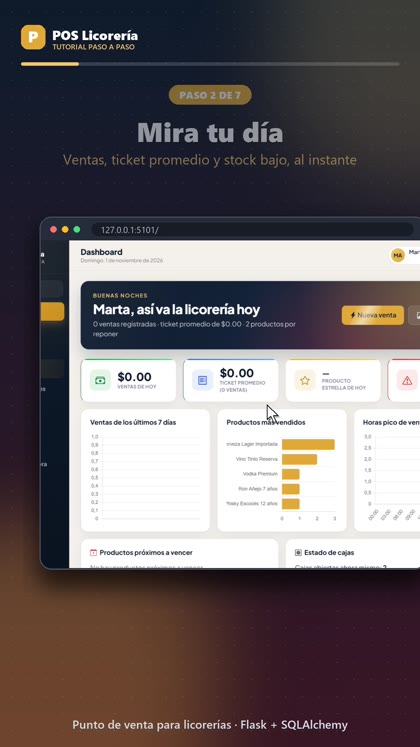
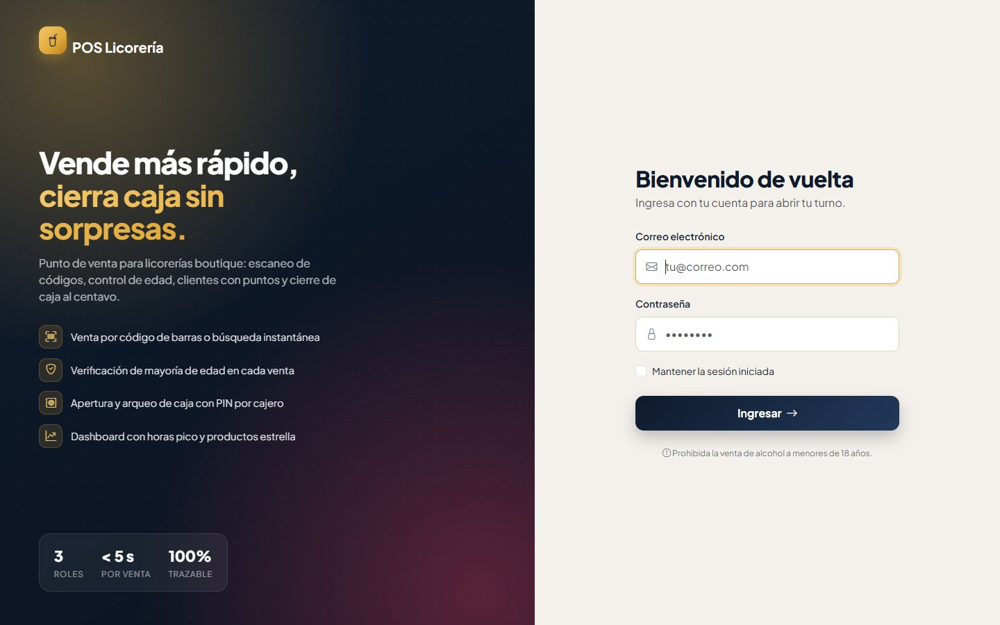
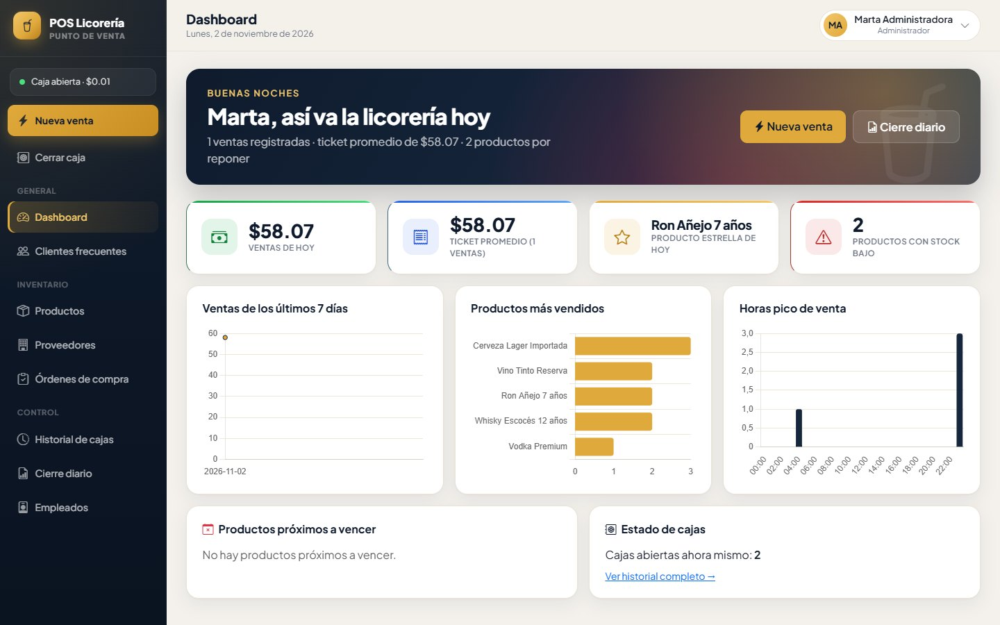
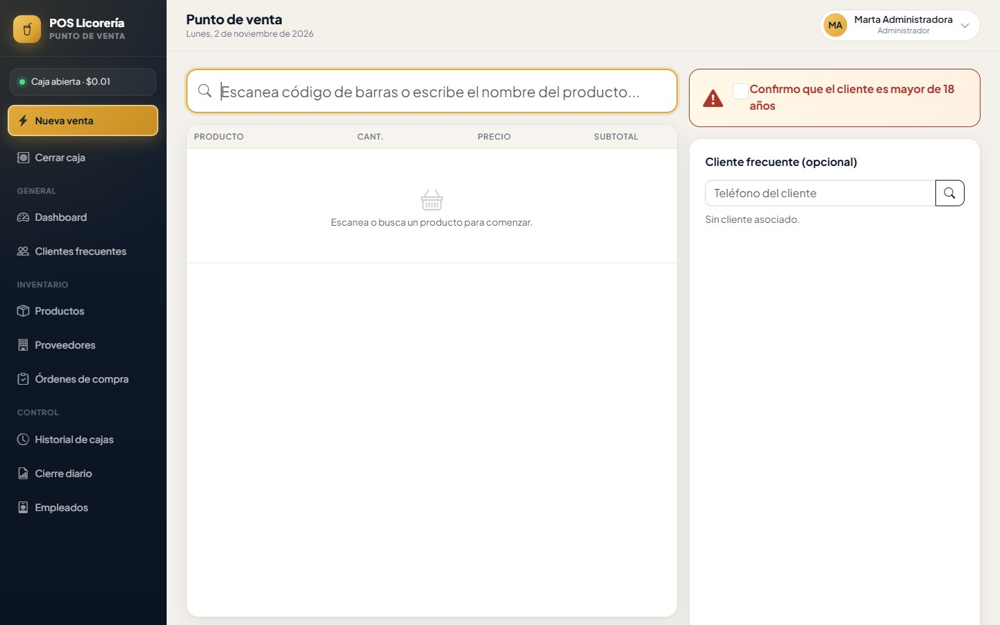
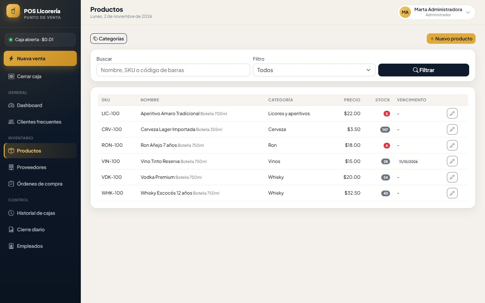

# POS Licorería — Sistema de Punto de Venta

Sistema de punto de venta (POS) para una licorería boutique: venta rápida
tipo mostrador (búsqueda por código de barras/nombre, teclado numérico
táctil, cálculo automático de cambio), control de apertura/cierre de caja
con arqueo, inventario en tiempo real con alertas de stock mínimo y
vencimiento, programa de puntos para clientes frecuentes, y reportes de
cierre diario exportables a PDF/Excel.

## 🎬 Demo en video

Tutorial paso a paso (vertical, ~40 s), grabado sobre el sistema real:

[](docs/video/tutorial-pos-licoreria.mp4)

▶️ **[Ver el video tutorial](docs/video/tutorial-pos-licoreria.mp4)**

## 📸 Capturas

| | |
|---|---|
|  |  |
| *Login a pantalla dividida* | *Dashboard con saludo y KPI animados* |
|  |  |
| *Pantalla de venta táctil* | *Inventario de productos* |

## Stack

- **Backend:** Python + Flask (arquitectura MVC)
- **Base de datos:** PostgreSQL + SQLAlchemy (ORM) + Flask-Migrate (Alembic)
- **Autenticación:** Flask-Login (roles cajero/supervisor/administrador)
- **Vistas:** Jinja2 + Bootstrap 5 + Chart.js
- **Reportes:** ReportLab (PDF) + openpyxl (Excel)

## Estructura (MVC)

```
app/
├── models/          # Modelos SQLAlchemy (M)
├── controllers/     # Blueprints de Flask (C)
├── templates/        # Vistas HTML — pantalla POS táctil + paneles internos (V)
├── static/            # CSS (paleta "boutique de vinos") y JS (POS + gráficos)
└── utils/               # Decoradores de rol, carrito de venta en sesión, reportes
config.py
run.py
seed.py                    # Datos de ejemplo para desarrollo
```

## Instalación

```bash
python -m venv venv
venv\Scripts\activate          # Windows
pip install -r requirements.txt

createdb pos_licoreria
cp .env.example .env           # y completar DATABASE_URL / SECRET_KEY

flask --app run.py db init
flask --app run.py db migrate -m "Esquema inicial"
flask --app run.py db upgrade

python seed.py                 # empleados, productos, clientes de ejemplo
flask --app run.py run --debug
```

## Usuarios de prueba (creados por `seed.py`)

| Rol           | Email                          | Contraseña       | PIN rápido |
|---------------|----------------------------------|-------------------|------------|
| Administrador | admin@poslicoreria.com           | admin123          | 1111       |
| Supervisor    | supervisor@poslicoreria.com      | supervisor123     | 2222       |
| Cajero        | cajero@poslicoreria.com          | cajero123         | 3333       |

Clientes frecuentes de prueba (para probar el programa de puntos en el
POS): teléfono `5551112222` (45 pts) y `5553334444` (120 pts).

## Flujo de uso

1. **Login** → un cajero es enviado directo al punto de venta; supervisor y
   administrador al dashboard.
2. **Abrir caja** (`/caja/abrir`): obligatorio antes de poder vender —
   registra el efectivo inicial del turno.
3. **Punto de venta** (`/pos`): escanea o busca productos, ajusta
   cantidades, confirma la alerta de mayoría de edad, asocia un cliente
   frecuente (opcional, con canje de puntos), elige método de pago y
   completa la venta con cambio calculado automáticamente.
4. **Cerrar caja** (`/caja/cerrar`): arqueo — compara el efectivo esperado
   por el sistema contra el contado físicamente y registra la diferencia.
5. **Dashboard** (`/dashboard`): KPIs del día + gráficos de ventas por
   periodo, productos más vendidos y horas pico.
6. **Inventario** (`/productos`): alertas de stock bajo y próximos a
   vencer; **Proveedores** (`/proveedores`) y **Órdenes de compra**: al
   marcar una orden como recibida, se suma el stock automáticamente.
7. **Cierre diario** (`/reportes/cierre-diario`): resumen exportable a PDF
   y Excel.

## Diseño visual

| Color | Hex | Uso |
|---|---|---|
| Tinta nocturna | `#0F1B2D` | Sidebar, encabezados, botón de ingreso |
| Ámbar whisky | `#E0A93B` | Acentos, "Nueva venta", total a pagar |
| Vino | `#8E2C48` | Acento secundario en fondos y gráficos |
| Crema | `#F4F1EC` | Fondo general |

Tipografía **Plus Jakarta Sans**. Estilo "bar nocturno": sidebar oscura con brillo ámbar, login a pantalla dividida, banner de bienvenida según la hora del día y botón destacado de "Nueva venta". La pantalla de venta mantiene botones grandes y teclado numérico táctil para tablet de mostrador.

**Animaciones** (`app/static/css/animaciones.css` + `app/static/js/animaciones.js`):
contadores que suben desde 0 en los indicadores, elementos que flotan,
destello en los botones principales, paneles que aparecen al hacer scroll y
puntos "en vivo". Todas se desactivan solas si el usuario tiene activada la
opción del sistema operativo de **reducir movimiento**.
